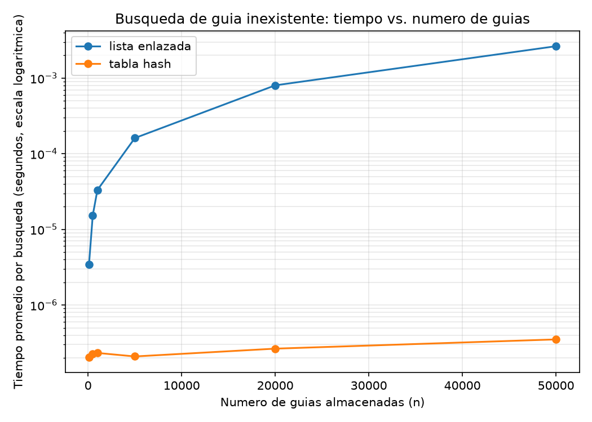
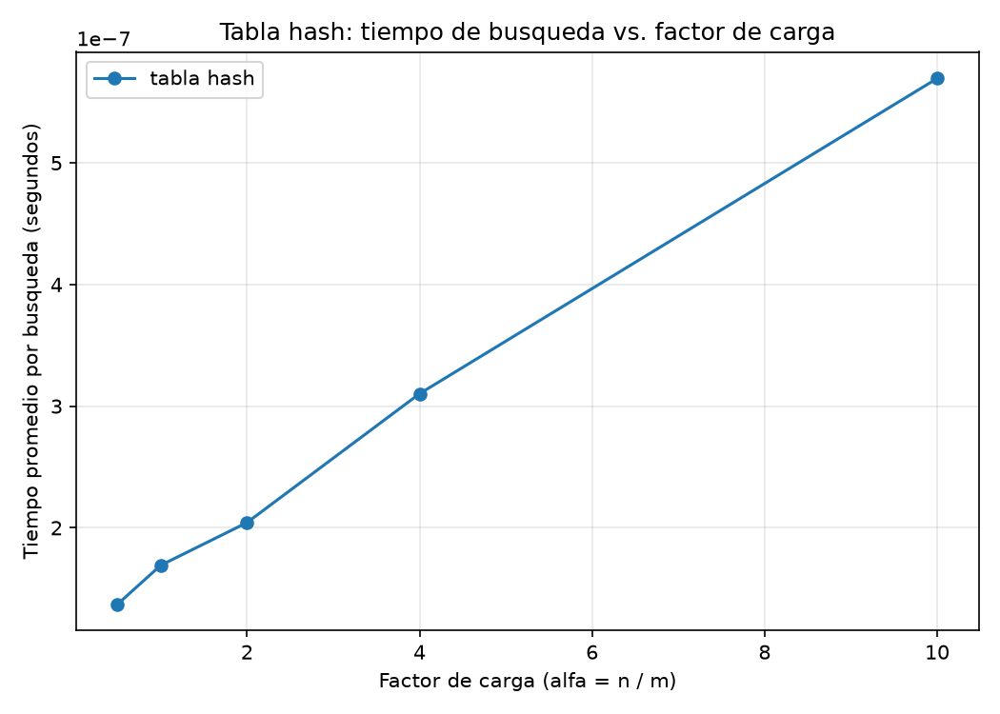

# Laboratorio evaluativo 03 - Estructuras de datos

Juan Pablo Correa Buitrago

## Instrucciones para reproducir el experimento

El repositorio usa el entorno virtual (`venv/`) de la raíz, con `matplotlib` instalado y registrado en `requirements.txt`. Desde la raíz del repositorio:

```
venv\Scripts\Activate.ps1
cd laboratorios/lab3-estructuras-datos
python pruebas.py
python medicion.py
```

`pruebas.py` corre los casos de verificación y termina imprimiendo "Todas las pruebas pasaron" si todo quedó correcto. `medicion.py` imprime en consola los dos experimentos y regenera las gráficas en `graficas/`.

## Parte 1 - Implementar y verificar las dos estructuras

Código: [estructuras.py](estructuras.py), [pruebas.py](pruebas.py).

`ListaEnlazada` inserta siempre al inicio (costo constante) y busca recorriendo nodo por nodo con un ciclo `while`, hasta encontrar la guía o llegar al final. `TablaHash` calcula la casilla con el método de la división (`guia % m`) y delega cada inserción y cada búsqueda en la `ListaEnlazada` de esa casilla, que es como se resuelven las colisiones por encadenamiento.

`pruebas.py` cubre: una búsqueda exitosa y una infructuosa en cada estructura; la colisión forzada con m = 7, donde las guías 10, 24 y 17 caen las tres en la casilla 3 (se verifica que la lista de esa casilla queda con tamaño 3, que las tres se pueden buscar después, y que una guía nunca insertada pero que también cae en la casilla 3, como 31, devuelve `None` en vez de confundirse con alguna de las otras); que `factor_carga()` da 3 / 7 tras esas tres inserciones; y 20 colecciones aleatorias, de tamaños entre 5 y 80 y con distintos valores de m, en las que la lista y la tabla deben coincidir tanto en las guías existentes como en una guía deliberadamente ausente.

## Parte 2 - Medir y graficar

Código: [medicion.py](medicion.py).





**Experimento A.** Se midió el tiempo promedio de 200 búsquedas de guías inexistentes, para n = 100, 500, 1000, 5000, 20000 y 50000. En cada n, la tabla se construyó con m igual al primo más cercano a n / 2 (buscado con una función de primalidad propia, sin librerías), de modo que el factor de carga quedara alrededor de 2 en los seis casos. Antes de medir, el experimento verifica que la lista y la tabla devuelvan el mismo estado para una muestra de guías existentes. Cada lote de 200 búsquedas se repitió 9 veces y se tomó el lote más rápido, por la misma razón que en el laboratorio anterior: el ruido del sistema operativo solo puede alargar una corrida, nunca acortarla.

**Experimento B.** Con n fijo en 20.000, se construyeron tablas con m ajustado para que el factor de carga tomara los valores 0.5, 1, 2, 4 y 10, y se midió el tiempo promedio de búsqueda de guías inexistentes en cada una. Aquí se usaron lotes de 3.000 búsquedas en vez de 200: una búsqueda en la tabla toma una fracción de microsegundo, y con lotes de 200 el tiempo total era tan corto que el reloj del sistema no alcanzaba a dar una lectura estable: la tabla de la Parte 3 muestra esa diferencia de magnitud.

| n | m | alfa | tiempo lista (s) | tiempo tabla (s) |
|---|---|---|---|---|
| 100 | 53 | 1.89 | 0.00000342 | 0.00000020 |
| 500 | 251 | 1.99 | 0.00001525 | 0.00000023 |
| 1000 | 499 | 2.00 | 0.00003317 | 0.00000023 |
| 5000 | 2503 | 2.00 | 0.00016113 | 0.00000021 |
| 20000 | 10007 | 2.00 | 0.00080211 | 0.00000026 |
| 50000 | 24989 | 2.00 | 0.00263861 | 0.00000035 |

## Parte 3 - Análisis

### 1. Costo teórico

Buscar una guía inexistente en la lista enlazada cuesta Theta(n): al no haber coincidencia en ningún nodo, el ciclo tiene que avanzar hasta el último (donde `siguiente` es `None`) antes de concluir que la guía no está, y no hay forma de saberlo antes de revisar los n nodos.

Buscar en la tabla con encadenamiento cuesta, en promedio, Theta(1 + alfa). El Theta(1) es el costo fijo de calcular el hash e indexar el arreglo de casillas; el Theta(alfa) es el costo esperado de recorrer la lista de esa casilla, que en promedio tiene alfa = n / m elementos. Esto se apoya en el supuesto de hash uniforme simple: cada guía tiene la misma probabilidad de caer en cualquiera de las m casillas, sin importar qué otras guías ya se insertaron. Si ese supuesto fallara al extremo y todas las guías cayeran en la misma casilla, la tabla se degradaría a una sola lista enlazada de tamaño n, y buscar volvería a costar Theta(n): la ventaja de la tabla depende de que el reparto sea razonablemente parejo.

### 2. Lo medido contra lo esperado

De n = 500 a n = 1000 (se duplica), la lista pasa de 0.0000153 s a 0.0000332 s, factor 2.18, cercano al 2 que predice Theta(n). De n = 5000 a n = 20000 (n se multiplica por 4), pasa de 0.000161 s a 0.000802 s, factor 4.98, muy cercano a 4. La tabla se mantiene entre 0.0000002 y 0.00000035 segundos en los seis tamaños, sin que n se multiplique hasta por 500: esa estabilidad es lo que predice Theta(1) cuando alfa se mantiene fijo, como ocurre aquí porque m se escogió como un primo cercano a n / 2 en cada caso. En la segunda gráfica, el tiempo de la tabla crece de 0.00000014 s en alfa = 0.5 a 0.00000057 s en alfa = 10: la dirección coincide con Theta(1 + alfa), aunque el aumento no es proporcional al de alfa (que se multiplicó por 20 y el tiempo solo por 4); a estas magnitudes, de fracciones de microsegundo, el costo fijo del hash pesa más, en términos relativos, que recorrer una cadena de en promedio menos de diez elementos.

### 3. Las colisiones

Una colisión ocurre cuando dos guías distintas producen el mismo valor de hash y caen en la misma casilla. Pasa incluso con más casillas que guías porque la función hash no reparte de forma perfecta: depende solo del residuo de dividir la guía entre m, y nada impide que varias guías compartan ese residuo. Con m = 7, las guías 10, 24 y 17 colisionan porque 10 mod 7, 24 mod 7 y 17 mod 7 dan los tres 3, como se comprueba en `pruebas.py`. El encadenamiento resuelve la colisión guardando una lista enlazada por casilla: las tres guías quedan en la lista de la casilla 3, que termina con tamaño 3. Su ventaja es que la tabla nunca se llena; su costo es que una casilla muy cargada se acerca al costo de una lista completa. El direccionamiento abierto busca otra casilla libre en el mismo arreglo: no necesita memoria para nodos enlazados, pero la tabla sí se puede llenar, y al llenarse las búsquedas se alargan y forman agrupamientos que degradan el rendimiento antes de agotar las casillas.

### 4. Tabla hash o árbol de búsqueda

La tabla hash no sirve para el monitoreo por rango. El valor de hash de una guía no guarda relación con su orden: dos guías consecutivas pueden caer en casillas distintas y lejanas, así que no hay forma de obtener las guías entre X y Y sin revisar las m casillas completas. Un árbol de búsqueda binario sí ofrece eso: al respetar el orden de las claves, un recorrido en orden entre dos nodos entrega las guías entre X y Y sin revisar las demás. Si las 400.000 guías llegaran ya ordenadas y se insertaran una a una, cada guía nueva sería siempre mayor que todas las anteriores, y el árbol degeneraría en una cadena de un solo lado: altura 400.000, igual que una lista enlazada, con hasta 400.000 comparaciones en el peor caso. Un árbol equilibrado con las mismas guías tiene una altura cercana a log en base 2 de 400.000, unos 19 niveles, y una búsqueda toma como máximo unas 19 comparaciones: la diferencia entre degenerado y equilibrado es, aquí, la diferencia entre 400.000 y 19 comparaciones.

### 5. Concepto para la jefa de operaciones

Recomiendo una combinación: tabla hash para la consulta puntual del call center, y un árbol de búsqueda binario balanceado para el monitoreo por rango; ninguna de las dos cubre bien las dos necesidades por sí sola. Escalando la medición de n = 50000 hasta 5.000.000 de envíos, sin regla de tres lineal: en la lista, el tiempo crece en proporción a n, así que un aumento de 100 veces en n implica un aumento de tiempo de unas 100 veces; sobre los 0.00264 s medidos, la búsqueda rondaría 0.26 s, ya notorio para un operador en línea. En la tabla, si m crece junto con n para mantener el factor de carga cercano a 2, el tiempo debería permanecer en el mismo orden medido: fracciones de microsegundo, indistinguible para el operador. Ambas cifras son estimaciones por extrapolación, no mediciones directas sobre 5.000.000 de envíos.
